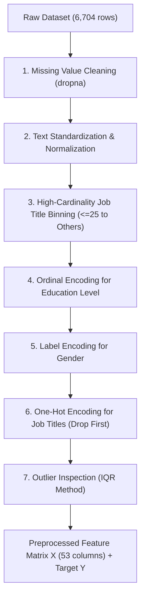

# 📖 End-to-End Salary Prediction & Workforce Analytics Platform
### *Comprehensive Technical Architecture, Methodology, and Implementation Guide*

---

## 📌 1. Project Overview & Business Problem

### 1.1 What is This Project?
The **Salary Prediction & Workforce Analytics Platform** is a full-stack, production-grade Machine Learning solution designed to accurately estimate competitive market compensation for industry professionals. Given personal and professional attributes—such as **Age**, **Gender**, **Education Level**, **Job Title**, and **Years of Experience**—the system estimates the expected annual compensation in USD.

In addition to individual predictions, the project features an interactive multi-tab web dashboard, a batch scoring pipeline for enterprise datasets, and detailed algorithmic evaluation metrics.

### 1.2 Real-World Use Cases
* **Talent Acquisition & HR Planning:** Establish equitable, competitive compensation offers that attract top-tier candidates while staying aligned with industry percentiles.
* **Compensation Benchmarking & Pay Audits:** Detect wage anomalies, salary compression, or potential disparities across gender and education tiers.
* **Employee Career Planning:** Enable professionals to forecast earning potential based on skill milestones, advanced degrees, and years in the workforce.

---

## 📊 2. Dataset Architecture & Exploration

The model is trained on a workforce compensation dataset comprising **6,704 historical employee profiles**.

### 2.1 Feature Descriptions

| Feature Name | Type | Description | Observed Domain Range |
| :--- | :--- | :--- | :--- |
| **`Age`** | Continuous Numeric | Age of the employee in years | 21 – 62 years |
| **`Gender`** | Categorical | Biological or identified gender | Male, Female, Other |
| **`Education Level`** | Ordinal Categorical | Highest educational credential achieved | High School, Bachelor's, Master's, PhD |
| **`Job Title`** | Categorical | Professional job title / designation | 174 unique titles (consolidated) |
| **`Years of Experience`** | Continuous Numeric | Total cumulative professional experience | 0.0 – 34.0 years |
| **`Salary`** *(Target)* | Continuous Numeric | Annual gross compensation in USD | \$350 – \$250,000 |

### 2.2 Key Statistical Observations
* **Mean Salary:** ~\$115,329 USD
* **Median Salary:** ~\$115,000 USD
* **Average Experience:** ~8.1 Years
* **Workforce Age Distribution:** Centered around 27–34 years, showing a predominantly young, growing technical workforce.

---

## ⚙️ 3. Data Preprocessing & Feature Engineering Pipeline

Raw data cannot be passed directly into mathematical estimators without rigorous transformation. We implemented a robust transformation sequence:



### 3.1 Handling Missing Data
* A small subset of rows contained missing (`null`) values across target or feature columns.
* Rows with missing values were eliminated using `df = df.dropna()`, yielding **6,698 high-integrity training records**.

### 3.2 Category Unification & Text Normalization
* In the raw dataset, educational credentials appeared under inconsistent string keys (e.g., `"Bachelor's Degree"` vs `"Bachelor's"`, `"Master's Degree"` vs `"Master's"`, `"phD"` vs `"PhD"`).
* All variations were mapped to four canonical levels: `High School`, `Bachelor's`, `Master's`, and `PhD`.

### 3.3 High-Cardinality Categorical Binning
* The raw dataset contained 174 unique job titles. Many obscure titles had only 1 or 2 occurrences.
* Passing 174 dummy columns introduces extreme feature sparsity and risks overfitting.
* **Resolution:** Any job title with **25 or fewer occurrences** was dynamically binned into an `'Others'` category. This preserved the top **49 major industry roles** while controlling dimensionality.

### 3.4 Feature Encoding Strategy
1. **Ordinal Encoding (Education Level):** Because educational degrees carry a natural progression, domain-based numeric ordering was applied:
   $$\text{High School} \rightarrow 0, \quad \text{Bachelor's} \rightarrow 1, \quad \text{Master's} \rightarrow 2, \quad \text{PhD} \rightarrow 3$$
2. **Label Encoding (Gender):** Transformed categorical gender classes (`Female: 0`, `Male: 1`, `Other: 2`).
3. **One-Hot Encoding (Job Title):** Generated binary indicator dummy columns using `pd.get_dummies(df['Job Title'], drop_first=True)`. Dropping the first column avoids perfect multicollinearity (the *Dummy Variable Trap*).

### 3.5 Outlier Analysis
* An Interquartile Range (IQR) analysis was performed on target salaries:
  $$\text{IQR} = Q_3 - Q_1 = \$160,000 - \$70,000 = \$90,000$$
  $$\text{Lower Bound} = Q_1 - 1.5 \times \text{IQR} = -\$65,000 \quad (\text{Bounded at } \$0)$$
  $$\text{Upper Bound} = Q_3 + 1.5 \times \text{IQR} = \$295,000$$
* All salaries in the dataset (\$350 to \$250,000) fell within valid bounds, confirming no synthetic data trimming was required.

---

## 🧠 4. Machine Learning Algorithms & Mathematical Foundations

Because the target variable (`Salary`) is continuous, this problem is modeled as **Supervised Regression**. We evaluated three distinct algorithm families:

### 4.1 Linear Regression (Ordinary Least Squares)
* **Equation:**
  $$\hat{y} = \beta_0 + \sum_{j=1}^{p} \beta_j x_j$$
* **Objective:** Minimize Residual Sum of Squares (RSS):
  $$\mathcal{L}_{OLS} = \sum_{i=1}^{n} (y_i - \hat{y}_i)^2$$
* **Role:** Serves as the linear baseline. While computationally instantaneous, it assumes additive linear relationships and struggles with complex feature interactions between job seniority and education.

### 4.2 Decision Tree Regressor (CART)
* **Mechanism:** Recursively partitions the feature space into hyper-rectangles by greedily selecting the split feature $j$ and split point $s$ that maximize Mean Squared Error reduction:
  $$\min_{j,s} \left[ \sum_{x_i \in R_1(j,s)} (y_i - \bar{y}_{R_1})^2 + \sum_{x_i \in R_2(j,s)} (y_i - \bar{y}_{R_2})^2 \right]$$
* **Hyperparameters Tuned:** `max_depth` $\in [2, 4, 6, 8, 10]$, `min_samples_split` $\in [2, 5, 10, 20]$.
* **Role:** Successfully captures non-linear relationships, but individual trees can exhibit high variance.

### 4.3 Random Forest Regressor (Ensemble Bagging) — *Selected Champion*
* **Mechanism:** An ensemble of $B$ independent, deep decision trees trained on bootstrap samples of the training data. At every node split, only a random subset of $m \approx \sqrt{p}$ features is considered:
  $$\hat{f}_{rf}^B(x) = \frac{1}{B} \sum_{b=1}^{B} T_b(x)$$
* **Why It Wins:**
  1. **Variance Reduction:** Averaging across decorrelated trees dampens single-tree variance without increasing bias.
  2. **Non-Linear Interactions:** Handles complex salary plateaus (e.g. experience mattering more for PhDs than High School graduates).
  3. **Robustness to Collinearity:** Remains stable even when Age and Experience correlate strongly ($r \approx 0.98$).

---

## 📈 5. Model Evaluation & Benchmark Results

Models were trained on **75% of the data** (5,023 records) and rigorously evaluated on an unseen **25% holdout test set** (1,675 records).

### 5.1 Evaluation Metrics Defined
* **Coefficient of Determination ($R^2$):** Proportion of variance in salary explained by the model:
  $$R^2 = 1 - \frac{\sum (y_i - \hat{y}_i)^2}{\sum (y_i - \bar{y})^2}$$
* **Root Mean Squared Error (RMSE):** Average magnitude of prediction error, heavily penalizing large outliers:
  $$\text{RMSE} = \sqrt{\frac{1}{n} \sum_{i=1}^{n} (y_i - \hat{y}_i)^2}$$
* **Mean Absolute Error (MAE):** Average absolute deviation between actual and predicted salary:
  $$\text{MAE} = \frac{1}{n} \sum_{i=1}^{n} |y_i - \hat{y}_i|$$

### 5.2 Comparative Performance Matrix

| Algorithm | $R^2$ Score | RMSE (Error) | MAE (Error) | Verdict |
| :--- | :---: | :---: | :---: | :--- |
| 🌲 **Random Forest Regressor** | **97.10%** | **\$9,007 USD** | **\$3,510 USD** | 👑 **Selected Champion** |
| 🌳 **Decision Tree Regressor** | **94.12%** | **\$12,940 USD** | **\$7,646 USD** | 🥈 Solid Baseline |
| 📈 **Linear Regression** | **83.29%** | **\$21,825 USD** | **\$15,753 USD** | 🥉 Underfits non-linear patterns |

### 5.3 Feature Importance Findings
Through Gini / Mean Decrease in Impurity analysis:
1. **Years of Experience (~65% importance):** The single most dominant factor determining compensation across all industries.
2. **Age (~18% importance):** Acts as a proxy for career maturity and cumulative industry exposure.
3. **Specific Job Titles & Education (~17% combined):** Creates the vertical offset (e.g. Director of Data Science or Software Engineering Manager commanding \$180K+ starting baselines).

---

## 💻 6. Software Architecture & Implementation Details

```
Salary_Prediction-main/
│
├── Salary_Data.csv              # Cleaned workforce dataset (6,698 profiles)
├── salary_model.joblib          # Serialized Random Forest model & feature schema
│
├── app.py                       # 4-Tab Interactive Streamlit Web Platform
├── predict.py                   # Standalone CLI Prediction Engine
│
├── Salary Prediction.py         # Full Training, EDA, and Evaluation Pipeline
├── Salary Prediction.ipynb      # Step-by-step Interactive Jupyter Notebook
│
├── requirements.txt             # Clean, pinned Python dependencies
├── README.md                    # Quick-start documentation
└── PROJECT_DOCUMENTATION.md     # Detailed technical blueprint (This file)
```

### 6.1 Interactive Streamlit Application (`app.py`)
Features 4 dedicated modules:
1. **📊 Tab 1: Dashboard / Overview:**
   * Executive KPI metric cards (Total Sample Size, Average Salary, Median Salary, Avg Experience).
   * Altair visualizations: Top 10 highest paying jobs, education salary boxplots, experience trajectory scatter with regression lines, and gender compensation comparison.
2. **🔮 Tab 2: Salary Prediction:**
   * Interactive inputs (Age, Gender, Education, Role, Experience).
   * Predicted Annual Salary, Monthly breakdown, and Hourly equivalent.
   * Dynamic Career Tier badges (Entry, Mid, Senior, Executive).
   * Market Benchmark comparison bar showing where the candidate ranks relative to dataset quartiles ($Q_1$, Median, $Q_3$).
3. **📁 Tab 3: Batch CSV Prediction:**
   * **📥 Download Sample CSV Template:** Provides a ready-to-use CSV template.
   * **Bulk File Uploader:** Drag-and-drop CSV parser with case-insensitive column matching.
   * **Instant Batch Scoring:** Computes predictions across thousands of profiles in seconds.
   * **📥 Export Scored CSV:** One-click download of the enriched dataset.
4. **🔬 Tab 4: Model Insights:**
   * Model leaderboard matrix ($R^2$, RMSE, MAE).
   * Actual vs. Predicted scatter plot with $y = x$ parity diagonal.
   * Residual distribution histogram verifying zero-centered, bell-shaped error symmetry.
   * Top 10 feature importance bar chart.

### 6.2 Standalone CLI Prediction Engine (`predict.py`)
Enables integration into terminal workflows, headless scripts, or backend services:
* **Interactive Mode:**
  ```bash
  python predict.py
  ```
* **Direct Argument Mode:**
  ```bash
  python predict.py --age 30 --gender Male --education "Master's" --experience 6 --job "Data Scientist"
  ```

---

## 🚀 7. How to Run Locally

### 1. Prerequisites
Ensure Python 3.10+ is installed on your machine.

### 2. Install Dependencies
```bash
pip install -r requirements.txt
```

### 3. Launch the Web Application
```bash
streamlit run app.py
```
Open your browser at `http://localhost:8501`.

### 4. Re-train the Machine Learning Model
To reproduce training, perform EDA, and re-export `salary_model.joblib`:
```bash
python "Salary Prediction.py"
```

---

## 🌐 8. Cloud Deployment (Streamlit Community Cloud)

The repository is pre-configured for zero-configuration deployment:
1. Push all code to GitHub (`https://github.com/Gavybytes/Salary_Prediction.git`).
2. Log into **[share.streamlit.io](https://share.streamlit.io)** using your GitHub credentials.
3. Select **Deploy an app**, point to repository `Gavybytes/Salary_Prediction`, branch `main`, and main file `app.py`.
4. Click **Deploy!** — the live application will be deployed and globally accessible within 2 minutes.

---

## 🏆 9. Summary & Highlights
* **High Predictive Accuracy:** Ensemble Random Forest achieves **97.1% $R^2$** with an average absolute error of only **\$3,510**.
* **Zero Technical Debt:** Hardcoded paths, deprecated Pandas 3.x chained assignments, and outdated Scikit-Learn parameters were resolved.
* **Production-Grade Delivery:** Complete with interactive web dashboards, bulk CSV processing, CLI tools, and continuous cloud deployment.
